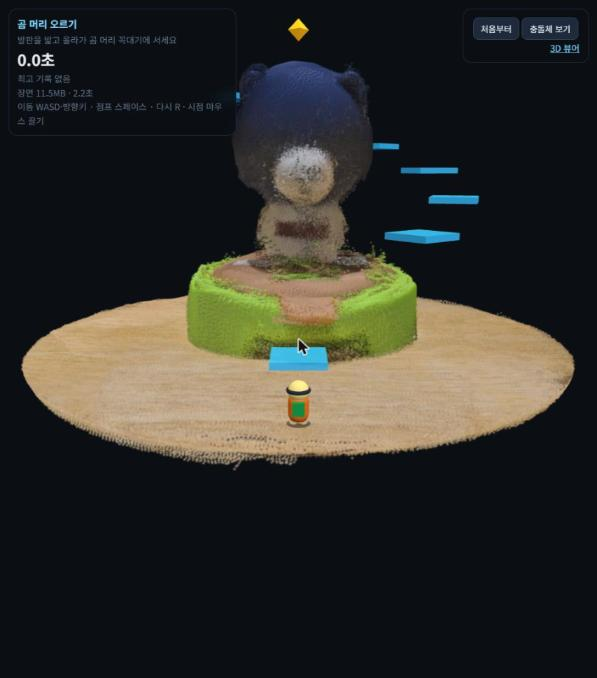
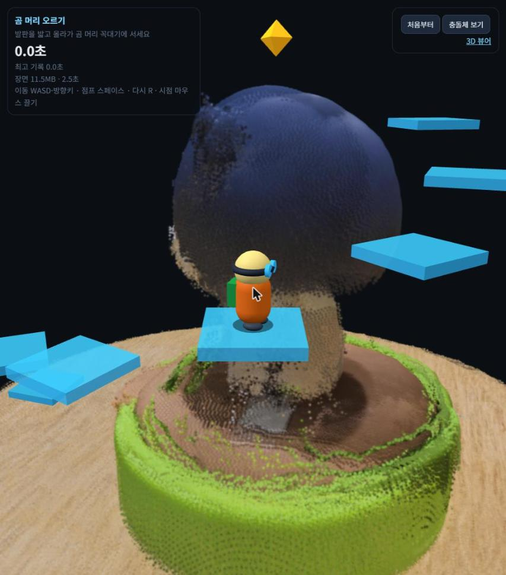

# 곰 머리 오르기 — 가우시안 스플랫 장면 위의 점프 게임

[곰 피규어 3D](https://basco-git.github.io/open-space/)에서 만든 장면(`scene.sog`, 알갱이 200만 개)에 작은 탐험가 캐릭터를 넣었습니다. 공중 발판을 밟고 곰 머리 꼭대기까지 올라가는 게임입니다. 3D 뷰어 과제의 추가 서브미션입니다.

- **플레이:** https://basco-git.github.io/bear-climb/
- **3D 뷰어:** https://basco-git.github.io/open-space/



## 하는 법

| | PC | 폰 |
|---|---|---|
| 이동 | WASD 또는 방향키 (카메라가 보는 방향 기준) | 왼쪽 아래 조이스틱 |
| 점프 | 스페이스 | 오른쪽 아래 "점프" 단추 |
| 시점 | 마우스로 끌기, 휠로 확대 | 화면을 한 손가락으로 끌기, 두 손가락으로 확대 |
| 다시 | R 또는 "처음부터" | "처음부터" |

- **목표:** 탁자 → 디딤돌 → 받침대 → 나선 발판 6개 → 곰 머리 꼭대기(노란 별 아래)에 서면 성공합니다.
- **기록:** 걸린 시간이 나오고, 최고 기록은 이 브라우저에만 저장됩니다.
- **떨어지면:** 탁자 밖으로 떨어지면 출발점으로 돌아갑니다.

## 어떻게 만들었나

**알갱이는 부딪히지 않습니다.** 가우시안 스플랫은 그리기 위한 것이라 딛고 설 면이 없습니다. 그래서 장면의 점에서 피규어의 높이별 반지름을 재고, 그 모양에 맞춰 보이지 않는 충돌체를 겹쳤습니다. "충돌체 보기" 단추로 볼 수 있습니다.

| 부분 | 충돌체 | 치수 (탁자 면 y=0, 피규어 축 = 원점) | 근거 |
|---|---|---|---|
| 탁자 | 원판 | 반경 0.9, 높이 0 | 탁자 점의 높이 중앙값 0.000, 반경 99% 0.915 |
| 받침대 | 원기둥 | 반경 0.45, 윗면 0.28 | 높이 0.05~0.30 구간 반경 0.38~0.49 |
| 몸통 | 원기둥 | 반경 0.17, 높이 0.28~0.55 | 높이 0.30~0.55 구간 반경 0.16~0.23 |
| 머리 | 구 | 중심 (0, 0.70, −0.05), 반경 0.27 | 가장 넓은 곳 0.70 부근, 꼭대기 0.93~0.97 |

이렇게 잴 수 있었던 것은 1·2차 정리에서 탁자 평면을 찾아 수평으로 돌리고 피규어를 원점에 세워 두었기 때문입니다.

**발판 배치:** 첫 디딤돌(높이 0.14)을 지나면 받침대 바깥에서 시작하는 나선 6칸(0.44 → 0.89)이 있습니다. 한 칸에 0.09씩 높아지고 34°씩 돕니다. 점프 높이는 약 0.18입니다(`v²/2g`, v=0.98, g=2.6).

**충돌 처리:**
- **윗면에 내려앉기:** 떨어지는 중에 바로 전 발 높이가 윗면보다 위였으면 그 윗면에 섭니다.
- **원기둥·발판 옆면:** 바깥으로 밀어냅니다.
- **머리(구):** 캐릭터 몸 중심의 작은 구와 겹치면 법선 방향으로 밀어냅니다. 법선이 위를 향하면(y > 0.55) 서 있는 것으로 봅니다.
- **발밑 그림자:** 캐릭터 바로 아래 가장 높은 윗면에 그림자를 그려, 공중에서도 높이를 가늠할 수 있게 했습니다.

## 시험

브라우저 탭이 화면에 보이지 않으면 화면 갱신이 멈춰 물리도 돌지 않습니다. 그래서 물리만 시간을 진행시키는 `game.simulate()`를 열어 두었습니다. 사람처럼 "목표 쪽으로 가다 점프하고, 목표 위에 오면 손을 떼는" 방식으로 모든 구간을 자동으로 뛰어 봤습니다.

| 조정 | 결과 |
|---|---|
| 처음 (발판 0.13, 40° 간격, 첫 칸 반경 0.47·높이 0.40) | 받침대 → 첫 발판 **실패**: 발판 아랫면(0.38)이 받침대에 선 캐릭터 머리(0.28+0.10)와 같은 높이라 머리를 박음 |
| 첫 칸을 받침대 밖(반경 0.55)·높이 0.44로 | 받침대 → 첫 발판 성공, 1→2 **실패** (중심 간 0.37로 가장 멂) |
| 간격 34°로 | 발판 가운데에서 뛰면 전 구간 성공, 뒤쪽 가장자리에서 제자리로 뛰면 5곳 실패 |
| **발판 0.15, 속도 0.62로 (지금)** | 가운데·가장자리 근처(0.04 뒤)에서 **전 구간 성공 → 꼭대기 도착 판정**. 맨 끝 가장자리(0.06 뒤)에서는 앞쪽 2곳 실패 (난이도로 남김) |



## 파일

```
index.html   게임 (three.js 0.180.0 + Spark 2.4.0, 빌드 없음)
scene.sog    장면 (곰 피규어 3D 2차와 같은 파일, 11.55MB)
shots/       캡처
```

## 곰 머리 오르기 진행 과정

목표: 3D 뷰어 장면 안에 캐릭터를 넣고, 발판을 밟아 곰 머리에 오르는 게임을 따로 된 주소로 공개한다.

| 순서 | 한 일 | 결과 |
|---|---|---|
| 1 | 장면 점에서 높이별 피규어 반지름 측정 | 탁자·받침대·몸통·머리 충돌체 치수 |
| 2 | 캐릭터(기본 도형 조합), 발판, 물리(중력·점프·착지·밀어내기), PC·폰 조작 작성 | `index.html` |
| 3 | 뷰어 저장소와 분리된 폴더로 이동 (사용자 요청: 게임은 다른 주소로) | `open-space/game/` |
| 4 | 자동 점프 시험 1차 | 받침대 → 첫 발판에서 머리 박음 발견 |
| 5 | 첫 발판 위치·높이, 간격 각도, 발판 크기, 속도 조정 후 재시험 | 전 구간 성공·꼭대기 도착 판정 확인 |
| 6 | 시험 때 0.0초 최고 기록이 저장된 문제 → 1초 미만 기록은 저장 안 함 | 기록 정상 |
| 7 | 시작 카메라를 뒤·위로, 캐릭터보다 0.22 위를 보며 따라가게 | 첫 화면에 목표까지 보임 (`shots/start.png`) |

## 회고 (곰 머리 오르기)

- 스플랫 장면은 부딪히는 면이 없어서, 점에서 잰 치수로 원기둥·구 충돌체를 따로 겹쳤음 → 앞 단계에서 탁자를 수평으로 맞춰 둔 덕분에 높이별 반지름만 재면 됐음.
- 숫자로 계산한 점프 거리로는 다 닿을 줄 알았는데, 받침대 위에서 발판 아랫면에 머리를 박는 것은 직접 뛰어 보기 전엔 몰랐음 → 자동 점프 시험을 만들어 구간마다 확인함.
- 브라우저 탭이 안 보이면 물리가 멈춰 첫 시험 결과가 엉터리였음 → 화면 갱신과 따로 물리만 진행시키는 시험 함수를 만들었음.
- 폰 조작(조이스틱·점프 단추)은 넣었지만 실제 폰에서 아직 해 보지 못했음.
